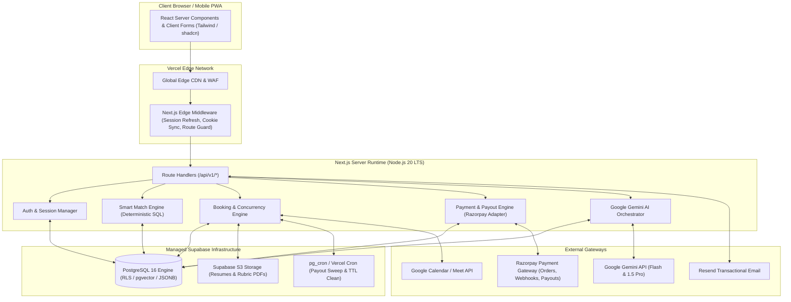

# DREAMX — CANONICAL PRODUCT REQUIREMENTS SPECIFICATION (PRD V1.0)
**Project:** DreamX — AI-Powered Career Success Marketplace  
**Document Version:** 1.0 (Canonical Master Specification)  
**Publication Date:** October 2026  
**Authoring Body:** Enterprise Architecture & Product Review Board (Principal Product Architect, Senior Full-Stack Architect, Supabase Security Specialist, Marketplace Systems Architect)  
**Status:** Canonical Baseline — Pending Final Executive Sign-Off  
**Direct Predecessors Audited:** `docs/prd.MD` (Evolution Blueprint), `Architecture.md`, `Backend.md`, `Frontend.md`, `Database.md`, `API.md`, `AI.md`, `Security.md`  

---

## 1. EXECUTIVE SUMMARY & POSITIONING

### 1.1 Executive Summary
DreamX is an AI-powered Career Success Marketplace engineered to transform how students and emerging professionals in India navigate high-stakes career transitions. By moving beyond unstructured, transactional hourly consultations, DreamX introduces a high-liquidity marketplace built on three standardized engagement pillars:
1. **One-Time Structured Services:** Ten standardized, fixed-deliverable services (e.g., Resume Review, Mock Interviews, Portfolio Audits) with guaranteed quality rubrics, platform-held escrow, and 72-hour payout holds.
2. **Flagship Structured Programs:** 2-week, 4-week, and 6-week cohort and 1:1 mentorship programs featuring milestone-based curriculum execution, weekly 1:1 calls, and a 60-day placement outcome guarantee.
3. **Continuous AI Guidance & Memberships:** An intelligent career co-pilot delivering real-time Career Readiness Scoring (0–1000), personalized action roadmaps, and tiered memberships (Free, Pro, Elite) with integrated AI token quotas.

The platform launches with an **India-First configuration** (INR pricing, Razorpay payment gateway, Indian Standard Time scheduling, 18% GST statutory accounting, and DPDP Act data privacy), backed by a modern, cloud-native **Next.js 14+ App Router Modular Monolith** and managed **Supabase PostgreSQL 16**.

### 1.2 Market Positioning & The "Goal-First" Paradigm
Traditional career platforms force students to guess which mentor can help them by browsing hundreds of unstructured mentor profiles ("Mentor-First"). DreamX inverts this model into a **"Goal-First" Marketplace**:
- Students state an immediate, high-urgency objective (*"I have an interview at Google in 48 hours"* or *"My resume is failing ATS screens"*).
- The platform immediately routes the student to either direct booking with verified mentors or dispatches an automated **Smart Match** request to the top-scoring mentors matching the student's target company, role, language, and budget.
- Mentors compete on quality and availability by submitting structured, binding offers with guaranteed deliverables.

```
TRADITIONAL DIRECTORIES (Unstructured, Leak-Prone)
Browse Mentors ──► Filter Bio ──► External Email/DM ──► Unstructured Call ──► Zero Accountability

DREAMX CANONICAL MODEL (Structured, Platform-Guaranteed)
State Goal ──► Smart Match / Direct ──► Binding Offers ──► Platform Hold ──► Standardized Rubric Deliverable ──► Score Lift
```

---

## 2. PROBLEM STATEMENT, PERSONAS & USER NEEDS

### 2.1 The Core Problems

#### For Job Seekers & College Students (The "Ananya" Cohort):
1. **The Guidance Vacuum:** Over 1.5 million engineering graduates enter the Indian job market annually with high academic marks but zero visibility into real-world interview rubrics, modern ATS screening heuristics, or system design expectations.
2. **Unstructured Consultation Anti-Patterns:** Traditional platforms sell 30-minute video calls. Mentors show up unprepared, offer generic verbal advice, and provide zero written feedback or post-call accountability.
3. **Timing Incompatibility:** Flagship 4-week mentorship bootcamps are too slow for urgent needs (*"My campus placement drive begins on Monday"*), while informal forums provide fragmented, unverified opinions.
4. **Opaque Pricing & Risk:** Students fear paying ₹1,500–₹3,000 to an unknown mentor with zero recourse if the session is unhelpful.

#### For Industry Mentors (The "Vikram" Cohort):
1. **High Inbound Admin Overhead:** Top software engineers and product managers at Google, Microsoft, and Amazon receive dozens of LinkedIn DMs asking for coffee chats and referrals. Triaging requests, negotiating fees, and chasing payments is exhausting.
2. **Unpredictable Schedules:** Tech professionals face shifting sprint deadlines. Rigid, multi-month cohort commitments lead to mentor burnout and high dropout rates.
3. **Leakage & Payment Insecurity:** Providing mentorship off-platform leads to unpaid sessions, awkward rate negotiations, and tax filing headaches.

### 2.2 Primary User Personas

| Persona Attribute | Ananya Sharma (Primary Student / Job Seeker) | Vikram Seth (Primary Industry Mentor) | Rahul Mehta (Platform Administrator) |
|---|---|---|---|
| **Demographics** | 21, Final Year B.Tech (IIT / NIT / Tier-2 Engg), Delhi NCR | 29, Staff Software Engineer at Tier-1 Tech (Google), Bangalore | 34, Head of Marketplace Operations, Mumbai |
| **Current Need** | Securing a ₹25LPA+ SDE-1 offer during upcoming placement drives | Monetizing 4 hours/week of spare time to give back and earn structured income | Maintaining marketplace liquidity, quality floors, and resolving disputes within 1h |
| **Pain Points** | Resume rejected by 20+ companies; nervous about behavioral & DSA mock rounds | Overwhelmed by unpaid LinkedIn requests; hates scheduling back-and-forth | Fraudulent mentor listings, student no-shows, payment gateway failures |
| **Platform Behavior** | Uses Smart Match for urgent mock interviews; tracks score progression; Pro subscriber | Sets recurring Sunday slots; accepts incoming Smart Match offers; uploads deliverable rubrics | Monitors dashboard triage; reviews pending mentor credentials; executes payout sweeps |
| **Willingness to Pay** | ₹499–₹1,499 for one-time services; ₹399/mo for Pro membership | Willing to pay 20% platform commission for zero-admin automated payouts | Platform administrator (system actor) |

---

## 3. GOALS, MEASURABLE SUCCESS METRICS & NON-GOALS

### 3.1 Strategic Product Goals
1. **Liquidity First:** Establish a functioning, high-conversion career marketplace where an urgent student request receives at least 2 qualified mentor offers within 30 minutes.
2. **Uncompromising Accountability:** 100% of marketplace transactions backed by platform escrow holds, standardized rubric templates, and mandatory deliverable verification before mentor payout release.
3. **Data-Driven Outcomes:** Every completed service or program milestone dynamically recalculates the student's Career Readiness Score (0–1000) and unlocks next-stage career actions.
4. **Zero-Trust Identity & Security:** Eliminate privilege escalation vulnerabilities, protect PII (resumes/salaries), and enforce strict database Row-Level Security (RLS) kernel authorization.

### 3.2 Measurable Success Metrics (Day 90 Post-Launch)

| Metric Category | Target KPI | Measurement Formula | Business Rationale |
|---|---|---|---|
| **Marketplace Liquidity** | **> 60%** | Active mentors with ≥1 booking / Total active mentors | Ensures healthy supply engagement; prevents dormant mentor churn. |
| **Time-to-First-Offer** | **< 30 minutes** | `Avg(time_offer_created - time_request_created)` | Critical speed metric for high-urgency student conversion. |
| **Match Success Rate** | **> 75%** | Requests with ≥1 submitted offer / Total submitted requests | Proves Smart Match algorithm effectively routes demand to available supply. |
| **Offer Acceptance Rate** | **> 35%** | Accepted offers / Total submitted offers | Proves mentor offers are priced competitively and well-targeted. |
| **Deliverable Quality SLA**| **> 98.5%** | Deliverables submitted within 24h meeting rubric floor / Total sessions | Ensures students receive high-value written takeaways. |
| **Dispute Escalation Rate**| **< 2.0%** | Disputed bookings requiring admin intervention / Total bookings | Proves alignment between service descriptions and student expectations. |
| **Platform Availability** | **99.9% Uptime** | Unplanned downtime minutes / Total monthly minutes | Enterprise-grade reliability during placement season peaks. |

### 3.3 Explicit Non-Goals (Out of Scope for Launch MVP)
- **No Unstructured / Off-Platform Calls:** The platform will never support unmonitored "pay for a 15-minute phone call" without a platform-defined deliverable rubric.
- **No Direct Mentor Peer-to-Peer Cash Settlements:** All payments, fees, and payouts must flow through platform escrow via Razorpay. Direct UPI exchange is strictly forbidden.
- **No Automated AI Replacement of Mentors:** AI will not replace human mock interviews or generate fake mentor reviews. AI augments matching, evaluates resume text, and scores rubrics; human mentors provide empathy and judgment.
- **No Complex International Tax Sharding at Launch:** Cross-border VAT/GST withholding and multi-currency Stripe/PayPal routing are deferred to Phase 10 / V2. MVP launches exclusively under Indian tax jurisdiction (INR, 18% GST, Section 194-O TDS).
- **No B2B Recruiter Headhunting Portal at Launch:** Anonymized talent search for enterprise recruiters is deferred to V2.

---

## 4. MVP SCOPE & DEFERRED CAPABILITIES

```
┌────────────────────────────────────────────────────────────────────────────────────────┐
│ GROUP 1: FOUNDATION & AUTHENTICATION (Phase 1 Baseline)                                │
│ - Supabase Auth (Email/Password, Google OAuth, LinkedIn OIDC, Magic Link)             │
│ - Strict Role Isolation (Students public, Mentors admin-approved, Admins seeded)       │
│ - Zero-Trust RLS Policies on profiles, sessions, and configuration registries          │
│ - Fully Verified Next.js 14 App Router (Node.js/TS Modular Monolith)                   │
└────────────────────────────────────────┬───────────────────────────────────────────────┘
                                         ▼
┌────────────────────────────────────────────────────────────────────────────────────────┐
│ GROUP 2: CORE MARKETPLACE MVP (Phases 2 – 4)                                           │
│ - 10 Standardized One-Time Services with Price Floors/Ceilings & Rubric Templates     │
│ - Mentor Catalog, Profile Verification, and Recurring IST Availability Management      │
│ - Direct Slot Booking + 14-Dimension Smart Match Engine (Deterministic SQL Heuristic)  │
│ - Binding Mentor Offers with 15-Minute Soft Reservation State Machine                  │
│ - Razorpay Payment Checkout, Webhook Idempotency, 3-Day & 14-Day Payout Holds          │
└────────────────────────────────────────┬───────────────────────────────────────────────┘
                                         ▼
┌────────────────────────────────────────────────────────────────────────────────────────┐
│ GROUP 3: VALUE-ADD ENGINE (Phases 5 – 8)                                               │
│ - Google Gemini AI Resume Analysis & Interview Prep (768-dim Vector Embeddings)        │
│ - Career Readiness Score Algorithm (0–1000) with Dynamic Non-Portfolio Redistribution  │
│ - 10-Stage Guided Career Journey Progression Engine                                    │
│ - In-App Notification Center & Transactional Email Dispatch (Resend)                   │
└────────────────────────────────────────┬───────────────────────────────────────────────┘
                                         ▼
┌────────────────────────────────────────────────────────────────────────────────────────┐
│ GROUP 4: LATER RELEASES & DEFERRED CAPABILITIES (Post-Launch / V2)                     │
│ - Student Memberships & AI Token Wallets (Phase 6.5 Deferred: ₹399 Pro / ₹799 Elite)   │
│ - Global Multi-Currency Expansion (PayPal, Stripe, Cross-Border Tax Withholding)       │
│ - Anonymized Recruiter Hiring Pipeline & Verified Placement Badges                     │
│ - Automated Machine Learning Dynamic Weight Optimization (V2-V4 ML Roadmap)            │
│ - 8-to-12 Week Premium Career Accelerator Programs                                    │
└────────────────────────────────────────────────────────────────────────────────────────┘
```

---

## 5. USER JOURNEYS & USER STORIES

### 5.1 End-to-End User Journeys

#### Journey 1: Urgent Mock Interview via Smart Match (Student)
1. **Entry:** Ananya lands on `/discover`, selects goal: *"I have an interview tomorrow"*.
2. **Intake:** Submits role (SDE-1), target company (Google), preferred date/time (Tomorrow, 7:00 PM IST), and uploads current resume.
3. **Dispatch:** Match Engine filters mentors with Google experience, available tomorrow evening, and computes match ranking across 14 dimensions. Request dispatched to top 3 mentors.
4. **Offer Received:** Within 22 minutes, Mentor Vikram submits an offer: ₹999, 60 minutes, with custom note *"Includes 45m Google behavioral & system design + 15m Q&A"*.
5. **Accept & Lock:** Ananya clicks "Accept". The booking enters `pending_payment` with a 15-minute slot lock. Competing offers enter `reserved_pending_checkout`.
6. **Payment:** Razorpay checkout modal opens. Ananya pays ₹999 via UPI.
7. **Confirmation:** Razorpay webhook triggers instant transition: booking becomes `confirmed`, sibling offers become `declined`, Google Calendar invite with Google Meet link is generated automatically.
8. **Session & Deliverable:** Session occurs on Google Meet. Within 12 hours, Vikram uploads the standardized Google Mock Interview Rubric Report.
9. **Outcome:** Ananya reviews the rubric. Her Career Readiness Score updates from 640 to 715.

#### Journey 2: Mentor Onboarding & Service Listing (Mentor)
1. **Registration:** Vikram signs up via LinkedIn OAuth (`/signup`). Role defaults to `student` initially with mentor intent flag.
2. **Profile Submission:** Completes `/onboard` with work history (Google SDE-III), LinkedIn URL, proof of employment, and time zone (`Asia/Kolkata`). Status set to `pending_review`.
3. **Admin Verification:** Platform admin reviews credentials in `/dashboard/admin/mentors` and clicks "Approve". Role upgraded to `mentor` in `app_metadata` and `public.profiles`.
4. **Listing Services:** Vikram navigates to `/dashboard/mentor/services` and activates S05 (Behavioral Mock Interview at ₹999) and S01 (Resume Review at ₹699).
5. **Recurring Availability:** Configures weekly recurring availability: Tuesdays & Thursdays 7:00 PM – 9:00 PM IST, Sundays 10:00 AM – 2:00 PM IST.
6. **Earning & Settlement:** Delivers session; uploads deliverable. After 3-day dispute window, platform automated cron sweeps the ₹800 net earnings into eligible payout status, transferred to Vikram's verified bank account.

---

## 6. AUTHENTICATION, IDENTITY, SESSIONS & AUTHORIZATION

### 6.1 Authentication Methods & Standards
- **Primary Credentials:** Email + Password with strict client/server entropy enforcement:
  - Minimum 8 characters.
  - At least 1 uppercase letter, 1 lowercase letter, 1 number, and 1 special character.
- **Passwordless Fallback:** Email Magic Link / OTP via Supabase Auth (`verifyOtp`).
- **OAuth Providers:**
  - Google OAuth 2.0 (Approved for MVP).
  - LinkedIn OIDC (Approved for MVP).
  - Provider redirect URI: `https://<domain>/auth/callback`.
- **Session Restoration & Tokens:**
  - Managed via `@supabase/ssr` cookies (`sb-<project>-auth-token`).
  - Access token lifetime: 3,600 seconds (1 hour).
  - Refresh token lifetime: 30 days with rolling rotation.
  - Middleware intercepts every request, executes `supabase.auth.getUser()`, refreshes expired tokens, and guarantees `Set-Cookie` preservation across all redirects.

### 6.2 Callback Routing & Failure Handling
```
OAuth Provider / Magic Link
              │
              ▼
GET /auth/callback?code=xxx OR ?token_hash=yyy
              │
              ├─► Success: Exchange code for session cookies
              │          │
              │          ├─► User Profile Complete ──► Redirect to /dashboard/{role}
              │          │
              │          └─► User Profile Incomplete ─► Redirect to /onboard
              │
              └─► Error / Failure ────────────────────► Redirect to /login?error=auth_callback_failed
```

### 6.3 Authoritative Identity & Zero-Trust Role Management
1. **Single Source of Truth:** `auth.users.id` (UUIDv4) is the sole identity anchor. `public.profiles.id` is a 1:1 foreign key with cascading delete.
2. **Role Storage:**
   - Authoritative role: `auth.users.raw_app_meta_data ->> 'user_role'`. This field is signed into the JWT and **cannot be modified by the client**.
   - Mirror role: `public.profiles.role` for relational SQL queries.
3. **Eliminating Privilege Escalation (Security Fix):**
   - Public signup unconditionally sets `role = 'student'` in `app_metadata` and `profiles`. Any `role` passed in `raw_user_meta_data` is explicitly ignored by database triggers.
   - The RLS policy `policy_profiles_update` permits users to update **only non-sensitive profile columns** (`full_name`, `avatar_url`, `headline`, `bio`, `time_zone`, `target_career_market_id`, `languages_spoken`).
   - A database trigger (`prevent_profile_role_self_update`) aborts any update targeting `role` executed by non-admin users.
4. **Mentor Approval Pipeline:**
   - Any applicant wishing to mentor submits credentials via onboarding. Status: `verification_status = 'pending_review'`.
   - Admin verifies proof of employment via `/dashboard/admin/mentors`.
   - Admin executes `POST /api/v1/admin/mentors/{id}/approve` (protected by admin RBAC).
   - Server-side handler sets `app_metadata.user_role = 'mentor'`, `verification_status = 'active'`, and `role = 'mentor'`.

### 6.4 Role & Resource Permission Matrix

| Resource / Endpoint | Guest (Unauthenticated) | Student | Mentor | Platform Admin |
|---|---|---|---|---|
| **Public Catalog (`/services`, `/mentors`)** | View Active Only | View Active Only | View Active Only | View All (incl. Draft/Inactive) |
| **Book Service (`/api/v1/bookings`)** | Forbidden (401) | Create / View Own | View Where Assigned | View & Manage All |
| **Submit Smart Match Request** | Forbidden (401) | Create / View Own | View Dispatched Requests | View All |
| **Submit / Counter Offers** | Forbidden (401) | View Own / Counter | Create / Counter Own | View All |
| **Manage Services & Availability** | Forbidden (401) | Forbidden (403) | Manage Own Services/Slots | Manage All |
| **Upload Deliverable Rubric** | Forbidden (401) | Forbidden (403) | Upload for Own Bookings | Override / Admin Upload |
| **Dispute Deliverable** | Forbidden (401) | Dispute Own Booking | Respond to Dispute | Triage & Arbitrate |
| **View Financial Ledger & Payouts** | Forbidden (401) | View Own Receipts | View Own Earnings/Payouts | View & Release All Payouts |
| **Execute Admin Payout Release** | Forbidden (401) | Forbidden (403) | Forbidden (403) | Authorize Payout Batch |
| **AI Resume / Mock Inference** | Forbidden (401) | Execute Own Quota | Execute for Assigned Students | Unrestricted |

---

## 7. FUNCTIONAL REQUIREMENTS & ACCEPTANCE CRITERIA

### 7.1 FR-1: Goal-Based Discovery & Smart Match Intake
- **FR-1.1:** The platform must provide an interactive intake interface at `/discover` capturing: Goal Category, Target Role, Target Company Tier (Tier-1 FAANG, Unicorn, MNC), Stated Budget, Preferred Date, and Preferred Time.
- **FR-1.2:** Intake submissions must validate that `preferred_date` is within 14 days of current date and `preferred_time` maps to valid UTC minutes.
- **Acceptance Criteria (AC-1):**
  - Given an authenticated student, when they submit a valid intake payload, then a new record is created in `public.service_requests` with status `open` and an SLA expiry timer of 48 hours.
  - Given an unauthenticated user, when they attempt to submit, they are redirected to `/signup?redirect=/discover` with form state preserved in local storage.

### 7.2 FR-2: 14-Dimension Smart Match Engine
- **FR-2.1:** The match engine evaluates all active, verified mentors serving the target career market using a deterministic SQL ranking formula across 14 weighted dimensions:
  $$\text{Score} = \sum_{i=1}^{14} w_i \cdot s_i$$
  - Target Career Market Compatibility ($w=0.15$)
  - Company Alignment / Tier ($w=0.14$)
  - Role Alignment ($w=0.12$)
  - Verified IST Calendar Slot Availability ($w=0.12$)
  - Historical Rolling Rating ($w=0.10$)
  - Experience Seniority Level ($w=0.08$)
  - Language Compatibility ($w=0.08$)
  - Budget Ceiling Alignment ($w=0.06$)
  - Historical Response Latency ($w=0.05$)
  - Service Deliverable Track Record ($w=0.04$)
  - Active Booking Load Balancing ($w=0.03$)
  - Mentee Outcome Ratio ($w=0.01$)
  - Domain Specialization ($w=0.01$)
  - Geographic Context / Proximity ($w=0.01$)
- **Acceptance Criteria (AC-2):**
  - Given a match request, the engine must return top candidate mentor IDs in $< 500\text{ ms}$ (P95).
  - If identical match scores occur, tie-breaking prioritizes mentors with fewer active bookings to ensure marketplace load balancing.
  - The request is automatically dispatched to the top 3 scoring mentors.

### 7.3 FR-3: Mentor Offer Marketplace & Soft Reservation
- **FR-3.1:** Matched mentors receive real-time push and email notifications with request details. Mentors may submit an offer (`price`, `proposed_date`, `proposed_time`, `custom_message`) within 12 hours.
- **FR-3.2:** When a student accepts an offer:
  - The accepted offer transitions to `accepted_pending_payment`.
  - A booking record is created in `public.service_bookings` with status `pending_payment` and `checkout_ttl = NOW() + 15 min`.
  - All sibling offers on the same request transition to `reserved_pending_checkout`.
- **Acceptance Criteria (AC-3):**
  - Given an accepted offer, if Razorpay webhook `payment.captured` arrives within 15 minutes, booking transitions to `confirmed` and sibling offers permanently transition to `declined`.
  - Given an accepted offer, if 15 minutes elapse without payment capture, a background worker transitions booking to `expired`, reverts the accepted offer to `pending`, and restores sibling offers to `pending`.

### 7.4 FR-4: Standardized One-Time Services & Deliverables
- **FR-4.1:** Mentors may list up to 5 services from the 10 approved platform service types. Custom pricing must adhere strictly to platform floor and ceiling bounds:
  - S01: Resume Review (45m, Floor: ₹399, Ceiling: ₹1,499)
  - S02: ATS Resume Optimization (45m, Floor: ₹499, Ceiling: ₹1,799)
  - S03: LinkedIn Profile Review (30m, Floor: ₹249, Ceiling: ₹999)
  - S04: Portfolio Review (45m, Floor: ₹399, Ceiling: ₹1,499)
  - S05: Mock Interview - Behavioral (60m, Floor: ₹499, Ceiling: ₹1,799)
  - S06: Mock Interview - Technical (60m, Floor: ₹599, Ceiling: ₹1,999)
  - S07: Career Strategy Consultation (45m, Floor: ₹399, Ceiling: ₹1,499)
  - S08: Salary Negotiation Strategy (30m, Floor: ₹299, Ceiling: ₹1,199)
  - S09: Career Transition Roadmap (60m, Floor: ₹599, Ceiling: ₹1,999)
  - S10: Quick Career Q&A (20m, Floor: ₹149, Ceiling: ₹599)
- **FR-4.2:** Mentors must upload a standardized rubric deliverable within 24 hours of session completion.
- **Acceptance Criteria (AC-4):**
  - If mentor fails to upload deliverable within 48 hours of session, the booking auto-cancels and the student receives a full 100% refund.

---

## 8. MARKETPLACE, MENTOR, PROGRAM & BOOKING RULES

### 8.1 Structured Programs (2, 4, and 6-Week Durations)
1. **2-Week Sprint ("Interview Prep Crunch"):** 2 1:1 sessions, 2 weekly milestones, targeted for students with interviews within 14 days. Pricing: ₹499–₹999.
2. **4-Week Core Flagship:** 4 1:1 sessions, 4 weekly milestones, comprehensive preparation. Pricing: ₹999–₹1,999.
3. **6-Week Deep Accelerator:** 6 1:1 sessions, 6 weekly milestones, complete career switch roadmap. Pricing: ₹1,499–₹2,999.
4. **Milestone Progression:** Each program week consists of 1 1:1 video call + 1 structured student assignment submitted through the platform. Mentors must review and approve milestone deliverables before the next session unlocks.

### 8.2 Calendar Scheduling & Time Zone Handling
- All scheduling timestamps in database tables (`service_bookings`, `mentor_schedules`) are stored strictly in **UTC (`TIMESTAMPTZ`)**.
- Indian Standard Time (IST, `UTC+05:30`) is the default presentation format for India MVP.
- Mentors configure weekly availability using recurring weekday blocks (e.g., `day_of_week = 2`, `start_time_utc = '13:30:00'`, `end_time_utc = '15:30:00'`).
- Concurrency locks prevent overlapping bookings for the same mentor slot using PostgreSQL exclusion constraints or transaction-isolated row locks (`SELECT FOR UPDATE`).

---

## 9. PAYMENT, REFUND, COMMISSION & PAYOUT RULES

### 9.1 Financial Model & Unit Economics
The platform enforces deterministic financial accounting with zero deletions in financial ledgers.

```
┌────────────────────────────────────────────────────────────────────────┐
│ STANDARD INDIA MVP TRANSACTION SPLIT (Gross: ₹1,000.00 Service)        │
├────────────────────────────────────────────────────────────────────────┤
│ Student Gross Payment (Checkout):                      ₹1,000.00       │
│ Platform Commission (20.0%):                           ₹  200.00       │
│   ├─ Statutory GST Remittance (18% on Platform Fee):   ₹   30.51       │
│   └─ Net Platform Retained Margin:                     ₹  169.49       │
│ Net Mentor Base Settlement (Invariant 80.0%):          ₹  800.00       │
│   └─ Statutory TDS Deduction (1% u/s 194-O, credited): -₹    8.00       │
│ Net Bank Payout Dispatched to Mentor:                  ₹  792.00       │
└────────────────────────────────────────────────────────────────────────┘
```

### 9.2 Cross-Service Commission & Hold Rules

| Rule Parameter | One-Time Services | Structured Programs | Student Memberships (V2) |
|---|---|---|---|
| **Platform Commission Rate** | **20.0%** | **15.0%** | **0.0%** (100% platform revenue) |
| **Mentor Base Earning** | **80.0%** | **85.0%** | N/A |
| **Payout Escrow Hold** | **3 Days (72 Hours)** post-deliverable | **14 Days (336 Hours)** post-milestone | N/A |
| **Student Dispute Window**| **48 Hours** post-deliverable | **14 Days** post-completion | N/A (cancel auto-renew anytime) |
| **Money-Back Guarantee** | Deliverable Rubric Quality Guarantee | 60-Day Placement Outcome Guarantee | N/A (no partial-month refunds) |

### 9.3 Refund & Dispute Resolution Policy
1. **Mentor No-Show:** If mentor does not join Google Meet within 15 minutes of scheduled start, student receives instant 100% refund. Mentor reliability score penalized.
2. **Student No-Show:** If student does not join within 15 minutes, mentor receives full payout; zero refund issued.
3. **Deliverable Disapproval:** If student files dispute within 48 hours of deliverable submission citing failure to meet rubric criteria, admin operations inspects the deliverable. If non-compliant, full refund issued. If compliant, dispute dismissed and payout released.

---

## 10. AI FUNCTIONALITY & PROVIDER BOUNDARIES

### 10.1 AI Vision & Guardrails
DreamX utilizes Generative AI to eliminate administrative friction and provide continuous student evaluation, while preserving human mentors as the primary empathy and judgment providers.

```
┌─────────────────────────────────────────────────────────────────────────────────┐
│ AI ORCHESTRATION PIPELINE                                                       │
├─────────────────────────────────────────────────────────────────────────────────┤
│ 1. Vector Search & Match: Google text-embedding-004 (768 Dimensions)           │
│ 2. Fast Intent Parsing & Q&A: Google gemini-3.5-flash (< 1,200 ms SLA)          │
│ 3. Deep Resume & Rubric Analysis: Google gemini-1.5-pro (1M Token Context)      │
│ 4. Fallback Circuit Breaker: Deterministic SQL Heuristic if LLM latency > 3.0s   │
└─────────────────────────────────────────────────────────────────────────────────┘
```

### 10.2 Technical AI Specifications
- **Embeddings Table:** `ai.document_embeddings` with `embedding extensions.vector(768)` indexing mentor bios, skills, and student goal statements.
- **Privacy & PII Protection:** Automated regex/NER sanitization strips email addresses, phone numbers, PAN, and Aadhaar before forwarding payloads to Google Gemini API.
- **Prompt Injection Defense:** Strict separation of system instructions from user-submitted resume text; delimiters and JSON schema validation enforce structured outputs.

---

## 11. CAREER READINESS SCORE, JOURNEY & RECOMMENDATIONS

### 11.1 Career Readiness Score Framework (0–1000)
The Career Readiness Score provides students with an objective, quantified assessment of their market readiness across 4 core dimensions (250 points each):

```
                        TOTAL CAREER SCORE (0 - 1000)
                                      │
         ┌──────────────────┬─────────┴────────┬──────────────────┐
         ▼                  ▼                  ▼                  ▼
    RESUME & ATS       TECHNICAL &       INTERVIEW &       ACADEMIC &
     READINESS          PROJECTS         COMMUNICATION     EXPERIENCE
     (0 - 250)          (0 - 250)          (0 - 250)        (0 - 250)
```

#### Dynamic Weight Redistribution for Non-Portfolio Roles:
For software engineering (SDE) and data engineering tracks where visual portfolios are not required (`requires_portfolio = false`), the portfolio sub-dimension weight is redistributed dynamically:
- Technical Problem Solving (DSA & Architecture): +15% weight
- Technical Interview Articulation: +10% weight
- Result: Technical students are never penalized for lacking a graphic design portfolio.

### 11.2 The 10-Stage Career Journey
1. Stage 1: Self-Assessment & Career Market Goal Definition
2. Stage 2: Resume Overhaul & ATS Formatting
3. Stage 3: LinkedIn Profile & Professional Branding
4. Stage 4: Core Technical Competency Audit (DSA / System Design)
5. Stage 5: Portfolio / Capstone Project Validation
6. Stage 6: Behavioral & Cultural Fit Interview Mastery
7. Stage 7: Technical Mock Interview Simulation
8. Stage 8: Active Application & Referral Strategy
9. Stage 9: Live Interview Support & Triage
10. Stage 10: Offer Evaluation & Salary Negotiation Strategy

---

## 12. SECURITY, PRIVACY, DATA ACCESS & ABUSE PREVENTION

### 12.1 Zero-Trust Database Kernel Security
- PostgreSQL Row-Level Security (RLS) is enabled unconditionally on all application tables.
- Cross-tenant data leaks are prevented by binding policies to `auth.uid()` and signed `app_metadata` claims.
- The Supabase Service Role Key is strictly isolated to server-side environments (`process.env.SUPABASE_SERVICE_ROLE_KEY`) and never bundled into client-side JS bundles.

### 12.2 Privilege Escalation Hardening
- Client SDKs are prohibited from directly updating `public.profiles.role`.
- The `handle_new_user()` trigger rejects any role supplied in `raw_user_meta_data`, defaulting all accounts to `student`.
- Admin endpoints require explicit verification of `(auth.jwt() -> 'app_metadata' ->> 'user_role') = 'admin'`.

### 12.3 Indian Digital Personal Data Protection (DPDP) Act Compliance
- Users retain the right to download all personal career history and request permanent account erasure (`DELETE /api/v1/privacy/account`).
- Account erasure purges user PII and vector embeddings within 24 hours while retaining anonymized, aggregated financial ledger rows as required by statutory 7-year tax audit laws.

---

## 13. INFORMATION ARCHITECTURE & NAVIGATION

### 13.1 Sitemap & Route Architecture

```
/ (Landing Page & Value Proposition)
├── /discover (Goal-Based Intake & Match Gateway)
├── /services (Standardized One-Time Services Catalog)
│   └── /services/[slug] (Service Detail & Direct Booking)
├── /mentors (Browse Verified Mentors Directory)
│   └── /mentors/[slug] (Mentor Profile, Reviews & Available Slots)
├── /programs (Flagship 2, 4, 6-Week Programs Catalog)
│   └── /programs/[id] (Curriculum, Milestones & Enrollment)
├── /(auth)
│   ├── /login (Credentials, OTP & OAuth)
│   ├── /signup (Student Registration)
│   ├── /onboard (Profile Initialization & Market Selection)
│   └── /reset-password (Password Recovery)
├── /dashboard
│   ├── /dashboard/student (Student Home, Active Bookings, Score & Journey)
│   │   ├── /dashboard/student/bookings (Session Calendar & Deliverable Links)
│   │   ├── /dashboard/student/journey (10-Stage Progression Tracker)
│   │   └── /dashboard/student/score (Detailed Dimension Breakdown)
│   ├── /dashboard/mentor (Mentor Home, Scheduled Sessions & Inbound Requests)
│   │   ├── /dashboard/mentor/services (Service Management & Price Setting)
│   │   ├── /dashboard/mentor/availability (Recurring IST Availability Grid)
│   │   └── /dashboard/mentor/earnings (Payout Ledger, Holds & Bank Account)
│   └── /dashboard/admin (Admin Triage, Liquidity Metrics & Review Operations)
│       ├── /dashboard/admin/mentors (Credential Verification & Approval)
│       └── /dashboard/admin/payouts (Escrow Sweep & Batch Disbursement)
```

---

## 14. TECHNICAL ARCHITECTURE BOUNDARIES

### 14.1 The Next.js Modular Monolith
The platform is deployed as a single, highly performant **Next.js 14+ App Router Modular Monolith** hosted on Vercel Enterprise, backed by managed **Supabase PostgreSQL 16**.



---

## 15. DATA MODEL & API CONTRACT REFERENCES

### 15.1 Core Database Entity Relationships
- `auth.users` (1:1) -> `public.profiles`
- `public.profiles` (1:N) -> `public.mentor_services` (max 5 active)
- `public.profiles` (1:N) -> `public.mentor_schedules` (recurring UTC slots)
- `public.service_requests` (1:N) -> `public.service_offers`
- `public.service_offers` (1:1 accepted) -> `public.service_bookings`
- `public.service_bookings` (1:1) -> `public.payment_transactions`
- `public.service_bookings` (1:1) -> `public.payout_logs`
- `public.service_bookings` (1:1) -> `public.reviews`
- Detailed DDL schemas are defined in `docs/Database.md` and migrations `0001` through `0010`.

### 15.2 API Overview & Standards
All API endpoints follow RESTful conventions, enforce `snake_case` JSON properties, UUIDv4 identifiers, and standardized RFC 7807 error responses. Complete contracts are cataloged in `docs/API.md`.

---

## 16. PERFORMANCE, RELIABILITY & ACCESSIBILITY

- **API Latency SLA:** Standard REST endpoints `< 200 ms` P95; search and catalog queries `< 400 ms` P95; Smart Match ranking `< 500 ms` P95.
- **Frontend Web Vitals:** LCP `< 2.5s`, FID `< 100ms`, CLS `< 0.1` on 4G mobile connections.
- **Accessibility:** Full WCAG 2.2 Level AA compliance across all public and dashboard views.
- **System Availability:** 99.9% uptime SLA backed by multi-AZ PostgreSQL replication and automated daily point-in-time recovery (PITR) WAL archiving.

---

## 17. TESTING STRATEGY & DEFINITION OF DONE

### 17.1 Test Strategy Inventory
1. **Unit Testing:** Validates pricing splits, tax calculations, dynamic weight redistribution, and schedule time conversions (`scripts/test_milestone2_payments.ts`).
2. **Security & RLS Isolation Testing:** Automated script verifying cross-user isolation and asserting that students cannot read private bookings or modify roles (`scripts/test_phase0_3_auth_matrix.mjs`).
3. **End-to-End Flow Verification:** Full pipeline test covering user registration -> service listing -> match request -> offer creation -> accept -> mock payment -> deliverable upload -> payout hold release (`scripts/test_full_system_verification.mjs`).

### 17.2 Definition of Done (DoD)
A feature or release phase is declared Done only when:
- 100% of functional requirements and acceptance criteria pass verification.
- RLS policies prevent unauthorized access across guest, student, mentor, and admin roles.
- Zero TypeScript compiler warnings, lint errors, or unhandled promise rejections exist.
- Automated test scripts pass with 100% assertions green.
- Verified in staging browser environment with clean console logs.

---

## 18. PHASED IMPLEMENTATION ROADMAP & APPROVAL GATES

| Phase | Milestone Name | Key Deliverables | Verification Script / Gate | Status |
|---|---|---|---|---|
| **Phase 0** | Workspace & Repo Setup | Standalone Next.js root, Tailwind tokens, Supabase connection | `scripts/test_full_system_verification.mjs` | **DONE** |
| **Phase 1** | Auth & Identity Foundation | `@supabase/ssr` auth, role triggers, onboarding, profile schema | `scripts/diagnose_supabase_auth.mjs` | **DONE** |
| **Phase 2** | Configuration & Career Markets| Multi-market DB registries, India seed data, domain enums | Migration 0002 verification | **DONE** |
| **Phase 3** | Mentor Catalog & Schedules | Mentor profile, recurring slots, public directory, slug routing | `scripts/test_phase0_3_auth_matrix.mjs` | **DONE** |
| **Phase 4** | Services, Match & Offers | S01-S10 service types, 14-dim match engine, offer marketplace | `scripts/test_phase5_e2e.ts` | **DONE** |
| **Phase 5** | AI Engine & Embeddings | Gemini 3.5 Flash, 768-dim embeddings, resume audit, prep rubrics | `scripts/seed_mentor_embeddings.mjs` | **DONE** |
| **Phase 6** | Payments, Checkout & Payouts | Razorpay adapter, 18% GST split, direct gateway hold, webhooks | `scripts/test_phase6_payments_e2e.ts` | **DONE** |
| **Phase 7** | Notifications & Reviews | In-app notification center, Resend email dispatch, 20-session rating | `scripts/test_phase7_notifications_e2e.ts` | **DONE** |
| **Phase 8** | Career Score & Analytics | 0-1000 score engine, dynamic weight adjust, 10-stage journey | `scripts/test_phase8_career_analytics_e2e.ts` | **DONE** |
| **Phase 9** | Admin Operations & Triage | Dispute triage portal, mentor approval dashboard, payout sweep | Admin E2E smoke tests | **READY TO PLAN** |
| **Phase 10** | Global Readiness Config | India-only launch lockdown, DPDP compliance endpoints | DPDP audit check | **READY TO PLAN** |
| **Phase 11** | Launch & Production Cutover | Production domain cutover, live Razorpay keys, smoke testing | Browser subagent validation | **READY TO PLAN** |

---

## 19. RISK REGISTER

| Risk ID | Risk Description | Severity | Likelihood | Mitigation Strategy |
|---|---|---|---|---|
| **RSK-01** | Marketplace Liquidity Imbalance (High student demand, slow mentor response) | **HIGH** | Medium | SLA alert: If request unfulfilled after 2h, widen match radius and dispatch SMS/email alerts to top 5 mentors. |
| **RSK-02** | Off-Platform Disintermediation (Mentors and students taking bookings to private UPI) | **HIGH** | High | Guarantee & escrow locks: Only platform-booked sessions grant verified Career Readiness Score lifts and dispute protection. |
| **RSK-03** | LLM API Downtime or Rate Limiting during Campus Season | **MEDIUM** | Medium | Automatic circuit breaker: Instant fallback to deterministic SQL scoring heuristics with zero user interruption. |
| **RSK-04** | Deliverable Quality Degradation at High Volume | **MEDIUM** | Low | Mandatory standardized rubric checklists. Mentors with rating < 4.2 placed in review queue. |
| **RSK-05** | Double Booking Concurrency Spikes | **HIGH** | Low | Strict PostgreSQL row locking (`SELECT FOR UPDATE`) and 15-minute checkout reservation TTLs. |

---

## 20. DECISION REGISTER REFERENCE

All unresolved or pending architectural, business, and financial decisions are documented in detail within `PRD_DECISION_REGISTER.md`:
- **DEC-01:** Membership Pricing Model (Pending Sign-Off)
- **DEC-02:** Membership Discount Percentages (Pending Sign-Off)
- **DEC-03:** Tax Invariance & Mentor Earning Guarantee (Pending Sign-Off)
- **DEC-04:** Backend Architecture Specification Alignment (Pending Sign-Off)
- **DEC-05 through DEC-12:** Approved Canonical Standards

---

## 21. TRACEABILITY MATRIX

| PRD Section | Functional Req | Database Schema (`Database.md`) | API Endpoint (`API.md`) | Automated Test Script |
|---|---|---|---|---|
| **§6 Auth & Identity** | Zero-trust signup, role isolation | `public.profiles`, `auth.users` | `src/app/auth/callback/route.ts` | `scripts/test_phase0_3_auth_matrix.mjs` |
| **§7.1 Goal Discovery** | Intake submission, request SLA | `public.service_requests` | `POST /api/v1/smart-match/requests` | `scripts/test_full_system_verification.mjs` |
| **§7.2 Smart Match** | 14-dim matching, load balancing | `public.service_requests` | `GET /api/v1/smart-match/requests/[id]/matches` | `scripts/test_full_system_verification.mjs` |
| **§7.3 Offer System** | Soft reservation, 15m TTL | `public.service_offers` | `POST /api/v1/marketplace/offers/[id]/accept` | `scripts/test_milestone3_orchestration.ts` |
| **§7.4 One-Time Services** | S01-S10 service listing, rubrics | `public.mentor_services`, `service_types` | `GET /api/v1/services`, `POST /api/v1/mentors/me/services` | `scripts/test_full_system_verification.mjs` |
| **§8.1 Programs** | 2, 4, 6-week curriculum | `public.programs`, `program_milestones` | `POST /api/v1/programs/[id]/enroll` | `scripts/test_phase5_e2e.ts` |
| **§9 Payments & Payouts**| 20% commission, 18% GST, 3d hold | `public.payment_transactions`, `payout_logs` | `POST /api/v1/payments/checkout`, `/webhooks/razorpay` | `scripts/test_phase6_payments_e2e.ts` |
| **§10 AI Architecture** | Gemini 3.5 Flash, 768-dim vector | `ai.document_embeddings` | `POST /api/v1/ai/resume-analyze` | `scripts/test_ai_math_unit.ts` |
| **§11 Career Score** | 0-1000 score, dynamic weight | `public.career_score_history` | `GET /api/v1/students/me/score` | `scripts/test_phase8_career_analytics_e2e.ts` |
| **§12 Security & RLS** | Column protection, DPDP privacy | `public.profiles` RLS policies | All `/api/v1/*` routes | `scripts/diagnose_supabase_auth.mjs` |

---
*End of Canonical Specification. Approved for Engineering Baseline.*
