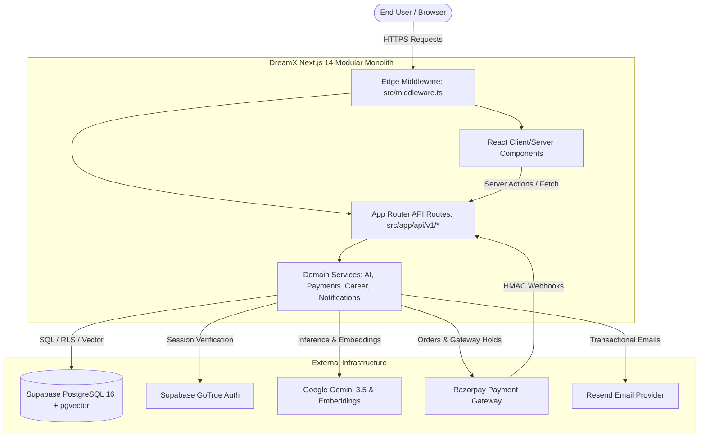
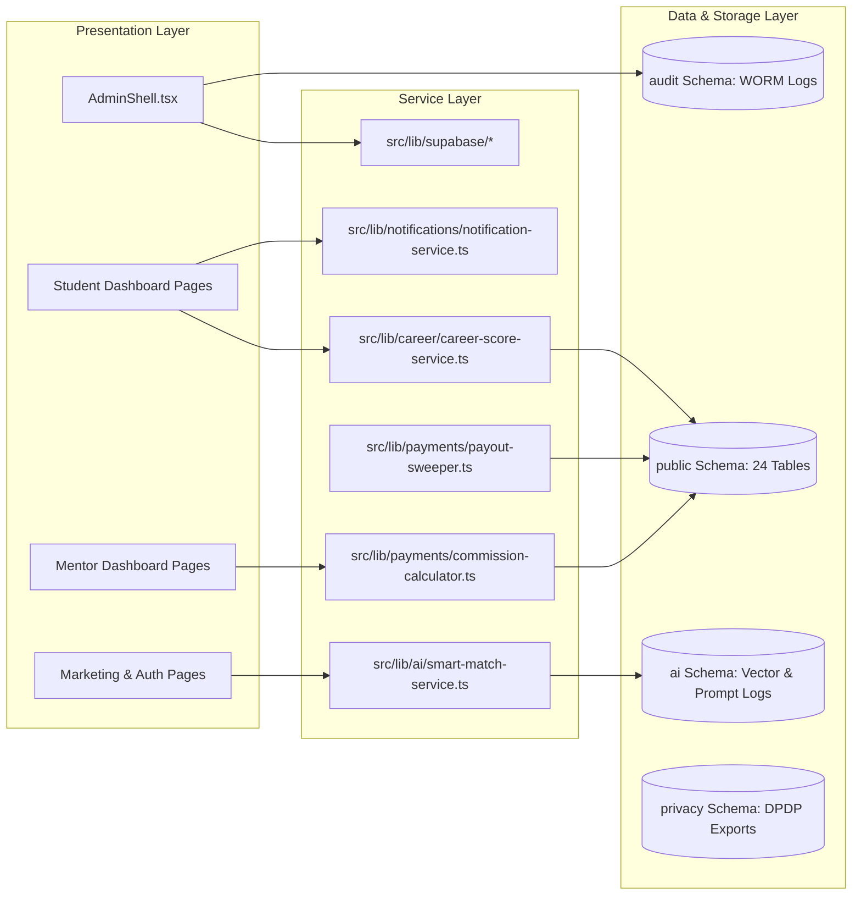
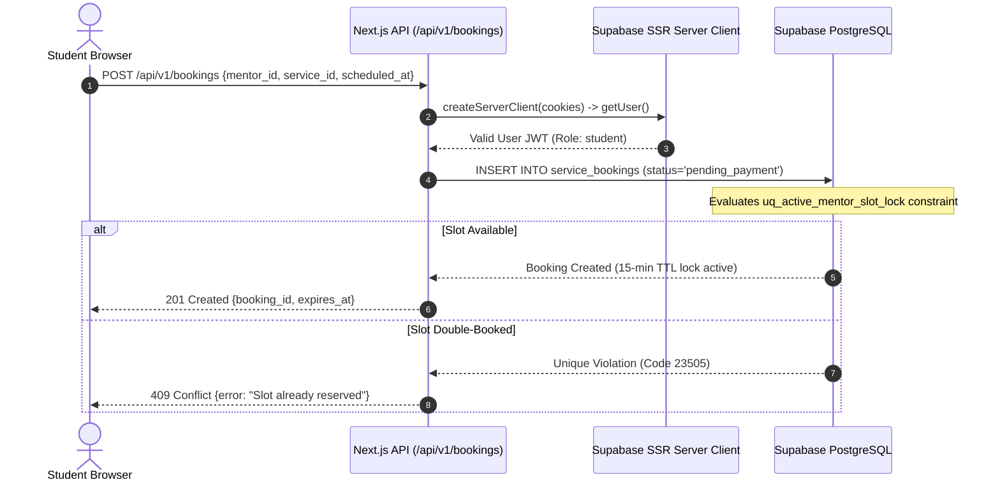
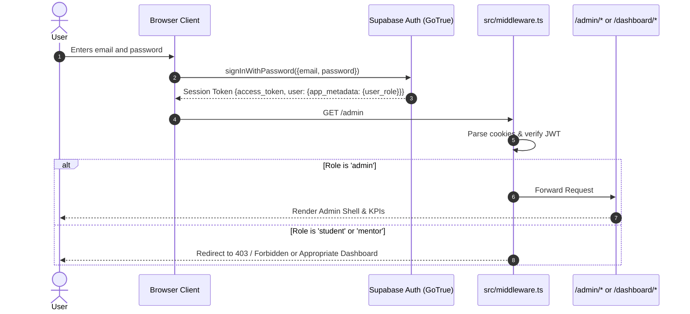
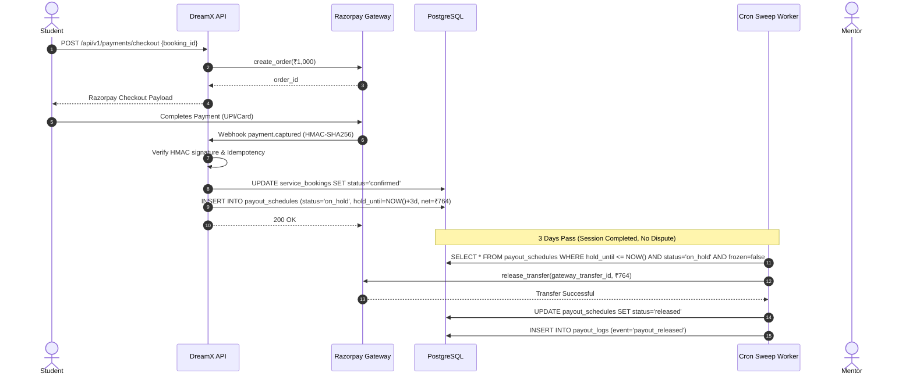
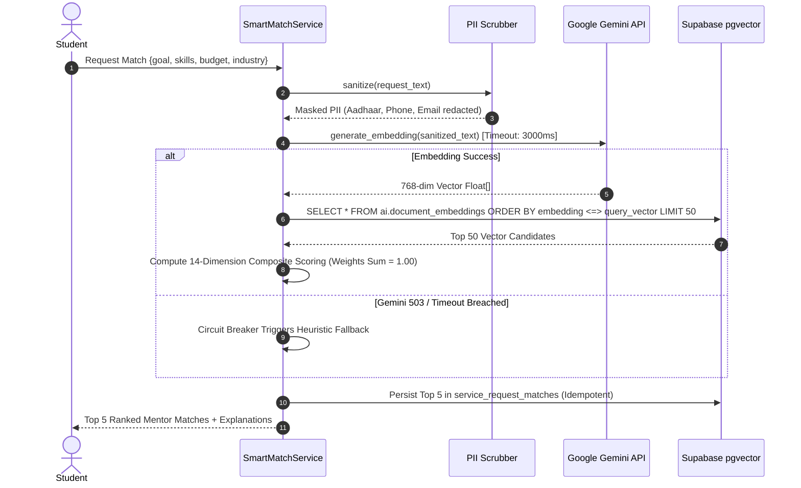
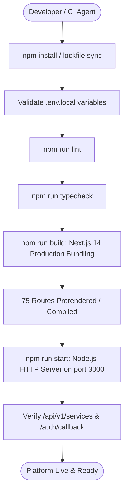

# DREAMX — ACTUAL ARCHITECTURE AND WORKFLOW SPECIFICATION

**Document Version:** 1.0.0 (Post-Phase 10 Verified)  
**Author:** Principal Software Architect  
**Scope:** Runtime Architecture, Boundaries, Lifecycles, and System Diagrams  

---

## 1. System Reality & Technology Stack

Contrary to early planning documents that proposed dual Node.js and FastAPI runtimes, DreamX runs as a **Next.js 14 App Router Modular Monolith** coupled directly to **Supabase PostgreSQL 16**.

### Actual Runtime Stack:
- **Application Framework:** Next.js 14.2.3 (React 18, TypeScript 5 Strict Mode)
- **Styling & UI Tokens:** Tailwind CSS 3.3.0, Radix UI Primitives, Lucide Icons
- **Database & Storage Engine:** Supabase Managed PostgreSQL 16
- **Vector Search Engine:** `pgvector` v0.8.2 (768-dimensional embeddings, HNSW Cosine Index)
- **Identity & Session Management:** Supabase GoTrue with SSR Cookie Sessions (`@supabase/ssr` 0.3.0)
- **AI Inference Engine:** Google Gemini (`gemini-3.5-flash` for reasoning, `gemini-embedding-001` for embeddings)
- **Payment Gateway:** Razorpay (Direct Gateway Hold-and-Release Payout Architecture)
- **Communications:** Resend (Email Adapter), WhatsApp Sandbox Adapter, Supabase Realtime (WebSocket channels)

---

## 2. Server/Client Boundaries & Client Usage Pattern

DreamX strictly enforces three distinct Supabase client instances to prevent security boundary crossing:

1. **Browser Client (`src/lib/supabase/client.ts`):**
   - Uses `createBrowserClient` with `NEXT_PUBLIC_SUPABASE_URL` and `NEXT_PUBLIC_SUPABASE_ANON_KEY`.
   - Used only in React Client Components (`'use client'`) for reactive state and Supabase Realtime channel subscriptions.
2. **Server SSR Client (`src/lib/supabase/server.ts`):**
   - Uses `createServerClient` with cookies storage handler from `next/headers`.
   - Reads user session JWT from request cookies. Enforces Row Level Security (RLS) under the authenticated user's identity.
3. **Admin Service Client (`src/lib/supabase/admin.ts`):**
   - Uses `createClient` with `SUPABASE_SERVICE_ROLE_KEY`.
   - Bypasses RLS strictly for kernel-level operations: WORM audit logging, webhook signature verification, cron sweeps, and administrative dispute overrides.

---

## 3. Core Architectural Sequences & Lifecycles

### 3.1 Authentication & RBAC Resolution
1. User submits email/password at `src/app/(auth)/login/page.tsx`.
2. Browser client sends credentials to Supabase GoTrue.
3. On authentication success, GoTrue returns JWT containing `app_metadata.user_role`.
4. Next.js edge middleware (`src/middleware.ts`) intercepts subsequent requests, refreshes session tokens via `@supabase/ssr`, and verifies role access:
   - `/admin/*` requires `app_metadata.user_role === 'admin'`.
   - `/dashboard/mentor/*` requires `app_metadata.user_role === 'mentor'`.
   - `/dashboard/student/*` requires `app_metadata.user_role === 'student'`.
5. Database trigger `trg_prevent_role_self_update` prevents role tampering at the PostgreSQL kernel level.

### 3.2 8-Stage Marketplace Negotiation & Booking State Machine
1. **Stage 1 (Request):** Student submits service request (`POST /api/v1/smart-match/requests`).
2. **Stage 2 (Offer):** Mentors submit proposals (`POST /api/v1/marketplace/offers`).
3. **Stage 3 (Negotiation):** Student/Mentor submit counter-offers (`POST /api/v1/marketplace/offers/[id]/counter`).
4. **Stage 4 (Acceptance):** Offer accepted (`POST /api/v1/marketplace/offers/[id]/accept`).
5. **Stage 5 (Slot Lock):** Booking created in `pending_payment` with 15-minute checkout TTL. Unique partial index `uq_active_mentor_slot_lock` prevents double-booking.
6. **Stage 6 (Checkout):** Razorpay order created via `POST /api/v1/payments/checkout`.
7. **Stage 7 (Confirmation):** Razorpay webhook `payment.captured` verified via HMAC-SHA256 (`src/app/api/v1/webhooks/razorpay/route.ts`). Booking transitions to `confirmed`. Google Meet link generated. Payout schedule created with status `on_hold`.
8. **Stage 8 (Completion & Hold):** Session completed (`POST /api/v1/bookings/[id]/complete`). Escrow hold countdown begins (3 days for services, 14 days for programs).

### 3.3 Direct Gateway Hold-and-Release Payout Lifecycle (PRD §13.6)
- **Zero Custody Invariant:** Platform database never holds raw settlement funds.
- **Commission Split:** Platform takes 20% commission (15% for programs) + 18% GST on commission. Mentor receives 76.4% net.
- **Dispute Freezing:** Opening a dispute (`POST /api/v1/admin/disputes`) sets `payout_schedules.frozen = true`, automatically excluding the row from the sweep worker.
- **Sweep Worker:** Automated cron sweep (`src/lib/payments/payout-sweeper.ts`) checks `hold_until <= NOW() AND status = 'on_hold' AND frozen = false` and calls Razorpay release API.

### 3.4 AI Smart Match & Fallback Pipeline
1. Input PII sanitized via regex scrubber (`src/lib/ai/scrubber.ts`).
2. Text bounded with `<user_input>` XML tags with delimiter neutralization.
3. 768-dim query embedding generated via `gemini-embedding-001`.
4. Cosine similarity query executed against `ai.document_embeddings` via pgvector `<=>` operator.
5. 14-dimension composite score calculated:
   - Career Goal Alignment (0.12), Career Market (0.10), Service Expertise (0.10), Skills (0.08), Industry (0.08), Languages (0.06), Timezone (0.06), Availability (0.08), Rating (0.08), Success Rate (0.06), Budget (0.06), Experience (0.04), Response Time (0.04), Cancellation Rate (0.04). All weights sum to exactly 1.00.
6. **Circuit Breaker:** If Gemini API call exceeds 3000ms SLA or returns 5xx error, fallback heuristic calculates matches deterministically.
7. Top 5 candidates persisted idempotently in `service_request_matches`.

---

## 4. Architectural Diagrams

### Diagram 1: System Context Diagram

### Diagram 2: Component & Dependency Diagram

### Diagram 3: Frontend-to-Backend-to-Database Request Sequence

### Diagram 4: Authentication and Authorization Sequence

### Diagram 5: Booking & Payment Lifecycle (Zero-Custody Hold & Release)

### Diagram 6: AI Smart Match Execution Sequence

### Diagram 7: Local Startup & Deployment Workflow

